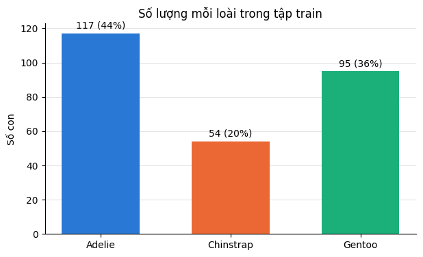
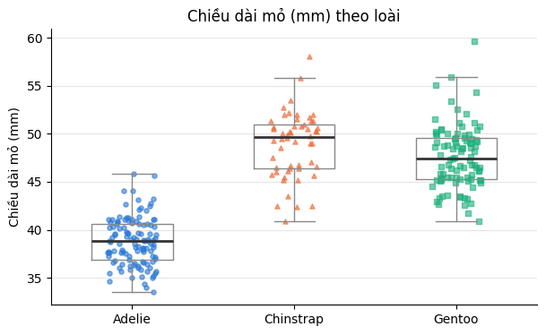
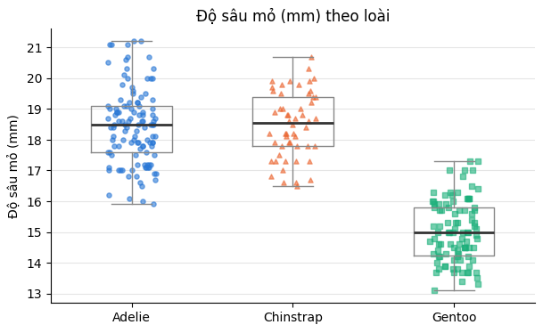
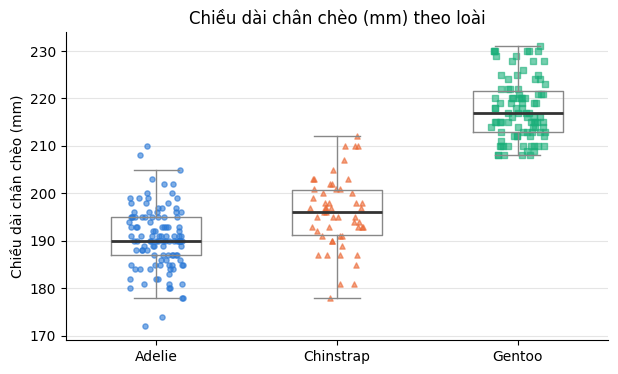
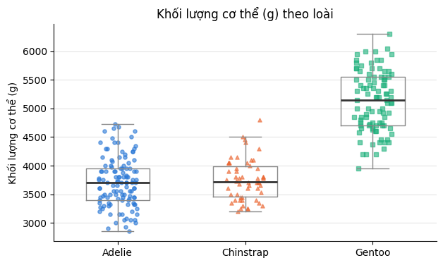
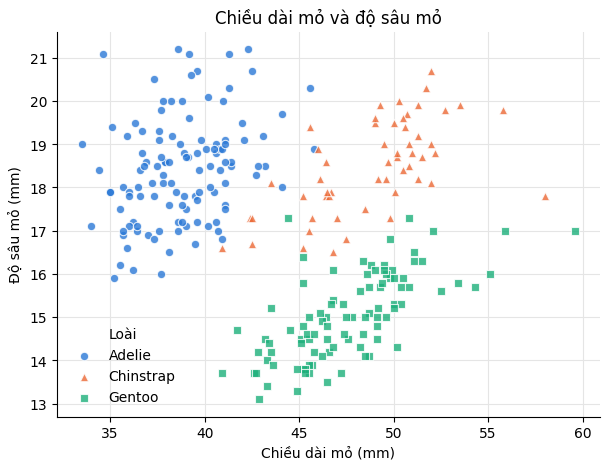
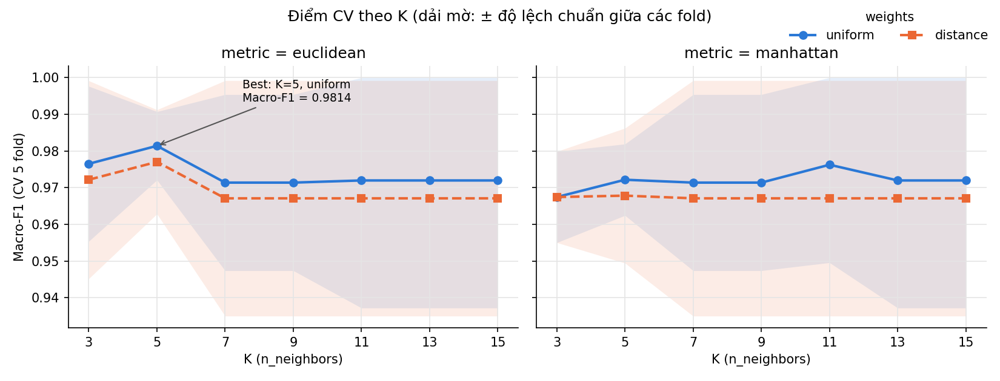
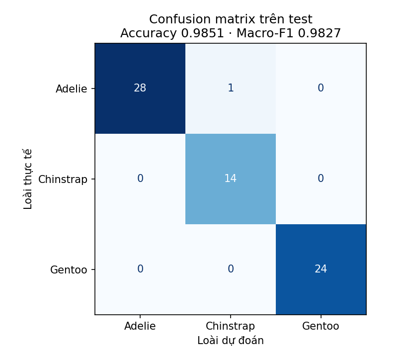

# Phân loại chim cánh cụt bằng KNN – Giải thích toàn bộ quá trình

Tài liệu này đi lại **từng bước** của phần ML: làm gì, ra kết quả gì, và **vì sao** lại làm như vậy.
Mỗi khái niệm được giải thích ngay lần đầu xuất hiện (khung `> Khái niệm`). Cuối tài liệu có phần tổng kết, các câu hỏi hay gặp khi bảo vệ và bảng thuật ngữ.

---

## Mục lục

0. [Bức tranh tổng thể](#0-bức-tranh-tổng-thể)
1. [Kiểm tra chất lượng dữ liệu](#1-kiểm-tra-chất-lượng-dữ-liệu)
2. [Làm sạch dữ liệu](#2-làm-sạch-dữ-liệu)
3. [Data dictionary](#3-data-dictionary)
4. [Chia train/test](#4-chia-traintest)
5. [EDA – khám phá dữ liệu](#5-eda--khám-phá-dữ-liệu)
6. [Baseline](#6-baseline)
7. [Thí nghiệm 1: không scale và có scale](#7-thí-nghiệm-1-không-scale-và-có-scale)
8. [Thí nghiệm 2: chọn K, metric, weights bằng GridSearchCV](#8-thí-nghiệm-2-chọn-k-metric-weights-bằng-gridsearchcv)
9. [Thí nghiệm 3: thêm sex và island](#9-thí-nghiệm-3-thêm-sex-và-island)
10. [Chốt model candidate](#10-chốt-model-candidate)
11. [Đánh giá cuối trên test](#11-đánh-giá-cuối-trên-test)
12. [Thí nghiệm 4: error analysis](#12-thí-nghiệm-4-error-analysis)
13. [Train model cuối và lưu file](#13-train-model-cuối-và-lưu-file)
14. [Tổng kết](#14-tổng-kết)
15. [Câu hỏi hay gặp khi bảo vệ](#15-câu-hỏi-hay-gặp-khi-bảo-vệ)
16. [Bảng thuật ngữ](#16-bảng-thuật-ngữ)

---

## 0. Bức tranh tổng thể

### Bài toán

Cho số đo của một con chim cánh cụt (chiều dài mỏ, độ sâu mỏ, chiều dài chân chèo, khối lượng, giới tính, đảo), đoán xem nó thuộc loài nào trong 3 loài: **Adelie**, **Chinstrap**, **Gentoo**.

> **Khái niệm – Phân loại (classification):** bài toán mà đáp án là một nhóm (loài A, B hay C), không phải một con số liên tục. Ở đây có 3 nhóm nên gọi là phân loại **3 lớp**.
>
> **Feature (đặc trưng):** thông tin đầu vào mà model được nhìn, ví dụ `bill_length_mm`.
> **Label / target (nhãn):** đáp án cần đoán, ở đây là `species`.

### Model dùng: KNN

> **Khái niệm – KNN (K-Nearest Neighbors, K láng giềng gần nhất):**
> KNN không "học" ra công thức nào cả. Nó **nhớ toàn bộ dữ liệu train**. Khi gặp một con chim mới:
> 1. Tính khoảng cách từ con mới tới **từng** con trong train.
> 2. Lấy **K** con gần nhất.
> 3. Xem trong K con đó loài nào chiếm nhiều phiếu nhất → đoán loài đó.
>
> Ví dụ K=5, trong 5 con gần nhất có 3 Chinstrap, 2 Adelie → đoán Chinstrap.
> Ý tưởng rất đời thường: "con này trông giống những con nào nhất thì chắc cùng loài với chúng".

### Kết quả cuối cùng (tóm tắt trước)

| | Accuracy | Macro-F1 |
| :--- | ---: | ---: |
| Baseline (đoán bừa loài đông nhất) | 0.44 | 0.20 |
| **Model cuối trên test** | **0.9851** | **0.9827** |

Model cuối đoán đúng **66/67 con** trong tập test.

### Toàn bộ quy trình

```
penguins.csv (344 dòng)
   │  check_data.py  → phát hiện 11 dòng thiếu dữ liệu, 0 dòng trùng
   ▼
clean_data.py → penguins_clean.csv (333 dòng)
   │
   ▼
prepare_data.py → train.csv (266 dòng, 80%) + test.csv (67 dòng, 20%, KHOÁ LẠI)
   │
   │  ── Từ đây mọi quyết định chỉ dựa trên train ──
   ├─ EDA (notebooks/eda.ipynb)          : hiểu dữ liệu
   ├─ baseline.py                        : mốc tối thiểu cần vượt
   ├─ experiment_scaling.py  (TN 1)      : có cần scale không?
   ├─ tune.py                (TN 2)      : chọn K, metric, weights
   ├─ experiment_features.py (TN 3)      : thêm sex, island có giúp không?
   └─ select_model.py                    : chốt config → config.json
   │
   │  ── Mở khoá test đúng MỘT lần ──
   ├─ evaluate.py                        : điểm cuối trên test
   ├─ error_analysis.py      (TN 4)      : vì sao con bị sai lại sai
   ▼
train_final.py → models/penguin_pipeline.joblib (backend load file này)
```

### Chạy lại toàn bộ

Từ thư mục gốc repo, kích hoạt môi trường ảo:

- **Linux / macOS**:
  ```bash
  source .venv/bin/activate
  ```
- **Windows (PowerShell)**:
  ```powershell
  .venv\Scripts\Activate.ps1
  ```
- **Windows (CMD)**:
  ```cmd
  .venv\Scripts\activate.bat
  ```

Sau đó chạy lần lượt các script (áp dụng cho cả Windows và Linux/macOS):

```bash
python ml/src/check_data.py
python ml/src/clean_data.py
python ml/src/prepare_data.py
jupyter nbconvert --to notebook --execute --inplace ml/notebooks/eda.ipynb
python ml/src/baseline.py
python ml/src/experiment_scaling.py
python ml/src/tune.py
python ml/src/experiment_features.py
python ml/src/select_model.py
python ml/src/evaluate.py
python ml/src/error_analysis.py
python ml/src/train_final.py
```

Mọi bước có `random_state=42` nên chạy lại sẽ ra đúng các con số trong tài liệu này.

---

## 1. Kiểm tra chất lượng dữ liệu

**File:** `src/check_data.py`

### Làm gì

Đọc `data/raw/penguins.csv` và in ra: số dòng, số cột, kiểu dữ liệu, số giá trị thiếu, số dòng trùng, số con mỗi loài, min/max các cột số.

### Kết quả

- 344 dòng, 8 cột.
- Số con mỗi loài: Adelie 152, Gentoo 124, Chinstrap 68.
- Không có dòng trùng lặp.
- Giá trị thiếu (ghi là `NA` trong file):

| Cột | Số giá trị thiếu |
| :--- | ---: |
| `sex` | 11 |
| `bill_length_mm` | 2 |
| `bill_depth_mm` | 2 |
| `flipper_length_mm` | 2 |
| `body_mass_g` | 2 |

**Điểm dễ hiểu nhầm:** "mỗi cột số thiếu 2" **không** có nghĩa là 8 con bị thiếu. Cả 4 cột thiếu ở **cùng 2 con**:

```
Adelie,Torgersen,NA,NA,NA,NA,NA,2007
Gentoo,Biscoe,NA,NA,NA,NA,NA,2009
```

Hai con này chỉ còn loài, đảo, năm. Còn `sex` thiếu 11 = 2 con trên + 9 con khác có đủ số đo nhưng không rõ giới tính.

### Vì sao phải làm bước này

Model không xử lý được ô trống: sklearn sẽ báo lỗi nếu gặp `NaN`. Và nếu có dòng trùng, một con chim có thể nằm cả trong train lẫn test → model "đã thấy đáp án" → điểm test cao giả. Phải biết dữ liệu có vấn đề gì trước khi làm bất cứ thứ gì khác.

---

## 2. Làm sạch dữ liệu

**File:** `src/clean_data.py` → ghi ra `data/processed/penguins_clean.csv`
**Chi tiết quyết định:** `data/data_quality.md`

### Quyết định: bỏ cả 11 dòng thiếu dữ liệu

**2 dòng thiếu toàn bộ số đo → bỏ**, vì:
- Model đoán loài dựa trên số đo. Hai dòng này không có số đo nào → không giúp model học được gì.
- Nếu điền (ví dụ lấy trung bình của loài đó) thì phải **dùng chính đáp án** (`species`) để điền → đó là gian lận, gọi là **data leakage**.

> **Khái niệm – Data leakage (rò rỉ dữ liệu):** khi thông tin về đáp án (hoặc về tập test) lọt vào quá trình train. Model trông rất giỏi lúc đánh giá nhưng ra thực tế thì kém, vì lúc đánh giá nó đã "nhìn trộm bài".

**9 dòng chỉ thiếu `sex` → cũng bỏ**, vì:
- Chỉ mất 2,6% dữ liệu. Chinstrap (loài ít nhất) không mất con nào.
- Nếu điền bằng giá trị phổ biến nhất ("male") thì sai khoảng một nửa, vì tỉ lệ đực/cái gần 50/50 (168 đực, 165 cái).

### Kết quả

333 dòng: Adelie 146, Gentoo 119, Chinstrap 68.

### Vì sao tách thành script riêng thay vì sửa file gốc

- `check_data.py` chỉ đọc, chạy bao nhiêu lần cũng không làm hỏng gì.
- `clean_data.py` ghi ra file mới, **file gốc giữ nguyên**. Nếu sau này đổi ý (ví dụ muốn giữ 9 dòng thiếu `sex`), chỉ cần sửa script và chạy lại.

### Làm sạch trước khi chia train/test có bị leakage không?

Không. Bỏ một dòng chỉ dựa vào **chính dòng đó** có ô trống hay không, không tính toán gì từ các dòng khác. Còn những việc như tính trung bình để điền, hay scale, thì **có** học từ dữ liệu, nên phải làm sau khi chia và chỉ học từ train (xem bước 7).

---

## 3. Data dictionary

**File:** `data/data_dictionary.md`

Mô tả từng cột: kiểu dữ liệu, vai trò (feature hay target), đơn vị, ý nghĩa, giá trị hợp lệ, có được thiếu không. Coi như "tài liệu schema" của bộ dữ liệu.

| Cột | Kiểu | Vai trò | Ghi chú |
| :--- | :--- | :--- | :--- |
| `species` | phân loại | **target** | Adelie, Gentoo, Chinstrap |
| `island` | phân loại | feature | Torgersen, Biscoe, Dream |
| `bill_length_mm` | số thực | feature | chiều dài mỏ, 32.1–59.6 mm |
| `bill_depth_mm` | số thực | feature | độ sâu (dày) mỏ, 13.1–21.5 mm |
| `flipper_length_mm` | số nguyên | feature | chiều dài chân chèo, 172–231 mm |
| `body_mass_g` | số nguyên | feature | khối lượng, 2700–6300 g |
| `sex` | phân loại | feature | male, female |
| `year` | số nguyên | (không dùng) | năm quan sát, 2007–2009 |

**Lưu ý nhỏ:** `flipper_length_mm` và `body_mass_g` là số nguyên nhưng pandas đọc file gốc ra `float64`. Lý do: trong pandas, số nguyên không chứa được `NaN`, nên cột nào có ô trống sẽ bị đổi sang số thực. Sau khi làm sạch, `clean_data.py` đổi lại về `int64`.

---

## 4. Chia train/test

**File:** `src/prepare_data.py` → `train.csv`, `test.csv`

### Làm gì

```python
train_test_split(X, y, test_size=0.2, random_state=42, stratify=y)
```

| | Số con | Adelie | Gentoo | Chinstrap |
| :--- | ---: | ---: | ---: | ---: |
| Train (80%) | 266 | 117 | 95 | 54 |
| Test (20%) | 67 | 29 | 24 | 14 |

### Vì sao phải chia

> **Khái niệm – Train / Test:**
> - **Train:** dữ liệu để model học và để mình thử nghiệm, chọn cấu hình.
> - **Test:** dữ liệu **giấu kín**, chỉ dùng **một lần** ở cuối để chấm điểm.
>
> Giống đi thi: làm bài tập (train) thoải mái, nhưng đề thi (test) phải là đề chưa thấy bao giờ. Nếu đã xem đề thi trước rồi ôn đúng đề đó thì điểm thi cao nhưng không phản ánh năng lực thật.

**Nguyên tắc quan trọng nhất của cả project:** từ bước này trở đi, **không nhìn test để chỉnh model**. Mọi lựa chọn (scale hay không, K bằng mấy, dùng feature nào) đều dựa trên train. Nếu chọn K vì "K=7 cho điểm test cao nhất" thì điểm test không còn khách quan nữa, vì mình đã chọn theo nó.

### Các tham số

- **`test_size=0.2`:** 20% làm test. Dữ liệu ít (333 con) nên không để test quá lớn, vẫn cần đủ dữ liệu cho train.
- **`random_state=42`:** cố định cách xáo trộn → chạy lại lần nào cũng chia y hệt → kết quả tái lập được. Số 42 không có gì đặc biệt, chỉ là quy ước phổ biến.
- **`stratify=y`:** giữ **tỉ lệ các loài** giống nhau ở train và test (Adelie ~44%, Gentoo ~36%, Chinstrap ~20%). Nếu không stratify, có thể xui xẻo test chỉ có 5 con Chinstrap → đánh giá Chinstrap không đáng tin.

---

## 5. EDA – khám phá dữ liệu

**File:** `notebooks/eda.ipynb` (ảnh xuất ra ở `reports/figures/eda_*.png`)

> **Khái niệm – EDA (Exploratory Data Analysis):** vẽ biểu đồ, tính thống kê để **hiểu dữ liệu** trước khi làm model. Mục đích là để ra quyết định (dùng feature nào, có cần scale không...), không phải để trang trí báo cáo.

**Chỉ dùng train.** Nếu làm EDA trên cả test thì những gì nhìn thấy trong test sẽ ảnh hưởng đến quyết định → test không còn độc lập.

### Biểu đồ 1 – Số lượng mỗi loài



Adelie 117 (44%), Gentoo 95 (36%), Chinstrap 54 (20%). Dữ liệu **hơi lệch**: Chinstrap chỉ bằng khoảng một nửa Adelie.
→ **Hệ quả:** không thể chỉ nhìn accuracy, phải dùng thêm **Macro-F1** (giải thích ở bước 6).

### Biểu đồ 2 – Chiều dài mỏ theo loài



Adelie mỏ ngắn rõ rệt (trung vị 38.8 mm), Chinstrap (49.7) và Gentoo (47.4) chồng lấn nhau.
→ Feature này **tách được Adelie** khỏi hai loài kia.

> **Khái niệm – Boxplot:** hộp chứa 50% dữ liệu ở giữa, vạch đậm trong hộp là **trung vị** (median, giá trị đứng giữa khi xếp từ nhỏ đến lớn). Mỗi chấm là một con chim.

### Biểu đồ 3 – Độ sâu mỏ theo loài



Gentoo mỏ mỏng hơn hẳn (15.0 mm), Adelie và Chinstrap gần như giống nhau (khoảng 18.5 mm).
→ Feature này **tách được Gentoo**.

### Biểu đồ 4 – Chiều dài chân chèo theo loài



Gentoo dài nhất (con ngắn nhất cũng 208 mm), gần như không chồng lấn. Adelie và Chinstrap chồng lấn nhiều.
→ Lại **tách được Gentoo**.

### Biểu đồ 5 – Khối lượng theo loài



Gentoo nặng hơn hẳn (trung vị 5150 g). Adelie và Chinstrap gần như bằng nhau (khoảng 3700 g).
Khối lượng tương quan rất cao với chân chèo (r ≈ 0.88): con chân chèo dài thường cũng nặng → hai feature này mang **gần như cùng một thông tin**.

> **Khái niệm – Tương quan (correlation, r):** đo hai đại lượng có "đi cùng nhau" không, từ -1 đến 1. r gần 1: cái này tăng thì cái kia tăng. r gần -1: cái này tăng thì cái kia giảm. r gần 0: không liên quan tuyến tính.

### Biểu đồ 6 – Chiều dài mỏ và độ sâu mỏ



**Biểu đồ quan trọng nhất.** Kết hợp hai số đo mỏ, 3 loài tách thành 3 cụm rõ ràng:
- Adelie: mỏ ngắn, dày (góc trên trái)
- Chinstrap: mỏ dài, dày (góc trên phải)
- Gentoo: mỏ dài, mỏng (phía dưới)

Chỉ có vài điểm lẫn nhau ở vùng mỏ dài 42–47 mm. **Model nhiều khả năng sẽ sai ở đúng vùng này** – và thực tế đã đúng như vậy (xem bước 12).

**Điều thú vị – Nghịch lý Simpson:** nếu tính chung cả 3 loài, mỏ dài và mỏ sâu tương quan **âm** (-0.25): mỏ càng dài thì càng mỏng. Nhưng trong **từng loài** lại tương quan **dương** (0.31 đến 0.67): mỏ dài thì cũng dày. Lý do: Gentoo vừa mỏ dài vừa mỏ mỏng, kéo xu hướng chung đi xuống. Bài học: nhìn dữ liệu gộp có thể rút ra kết luận **ngược** với thực tế trong từng nhóm.

### Bảng bổ sung – Loài theo đảo

| | Biscoe | Dream | Torgersen |
| :--- | ---: | ---: | ---: |
| Adelie | 33 | 45 | 39 |
| Chinstrap | 0 | 54 | 0 |
| Gentoo | 95 | 0 | 0 |

Gentoo chỉ ở Biscoe, Chinstrap chỉ ở Dream. `island` gần như "tiết lộ" đáp án – nhưng chỉ đúng với **bộ dữ liệu này**. Nếu gặp chim ở đảo khác, model sẽ bối rối.

### Kết luận EDA → quyết định

| Phát hiện | Quyết định |
| :--- | :--- |
| Mỗi số đo tách được 1 loài, kết hợp thì tách được cả 3 | Dùng cả 4 số đo |
| Các cột có thang đo rất khác nhau (mm vs g) | Cần scale (kiểm chứng ở TN 1) |
| Dữ liệu hơi lệch | Dùng Macro-F1, stratify |
| `island` tách loài quá mạnh | Thử có/không có (TN 3) |
| `year` là năm quan sát, không phải đặc điểm của chim | Không dùng |

---

## 6. Baseline

**File:** `src/baseline.py`

### Làm gì

```python
DummyClassifier(strategy="most_frequent")
```

Model "ngốc nhất": gặp con nào cũng đoán **loài đông nhất trong train** (Adelie). Không nhìn feature nào cả.

### Vì sao cần baseline

Để có **mốc so sánh**. Nếu model KNN đạt accuracy 0.44 thì nghe cũng được, nhưng thực ra không hơn gì đoán bừa. Baseline trả lời câu hỏi: "Model của mình có thực sự học được gì không?"

### Cách đánh giá: Cross-validation

Không được dùng test (đang khoá). Vậy chấm điểm bằng gì? → **Cross-validation** trên train.

> **Khái niệm – Cross-validation 5 fold (kiểm tra chéo):**
> 1. Chia 266 con train thành 5 phần (fold), mỗi phần khoảng 53 con.
> 2. Lần 1: học trên fold 2–5, chấm điểm trên fold 1.
> 3. Lần 2: học trên fold 1, 3–5, chấm trên fold 2.
> 4. ... lặp đủ 5 lần, mỗi fold được làm "đề kiểm tra" đúng một lần.
> 5. Lấy **trung bình** 5 điểm.
>
> Như vậy mọi con trong train đều được dùng để chấm đúng 1 lần, mà lúc chấm nó không nằm trong dữ liệu học. Điểm trung bình 5 lần đáng tin hơn 1 lần chia duy nhất.
>
> **Stratified**: mỗi fold giữ tỉ lệ loài giống nhau. `shuffle=True, random_state=42`: xáo trộn trước khi chia, cố định để tái lập.
>
> **Vì sao fold 1 có 54 con, các fold khác 53?** 266 / 5 = 53.2, không chia hết. Con dư được xếp vào fold đầu.

Mọi thí nghiệm sau đều dùng **cùng cách chia 5 fold này** → so sánh công bằng.

### Kết quả

```
Baseline Accuracy: 0.44 (± 0.01)
Baseline Macro-F1: 0.20 (± 0.00)
```

### Giải thích các con số

> **Khái niệm – Accuracy:** số con đoán đúng / tổng số con.
>
> **Khái niệm – Precision, Recall, F1 (cho từng loài):**
> - **Precision** của loài X: trong những con model **đoán là X**, bao nhiêu % đúng là X? ("đoán X có đáng tin không")
> - **Recall** của loài X: trong những con **thực sự là X**, model tìm ra được bao nhiêu %? ("có bỏ sót X không")
> - **F1** = trung bình điều hoà của precision và recall = 2·P·R / (P+R). Chỉ cao khi **cả hai** cùng cao.
>
> **Khái niệm – Macro-F1:** tính F1 cho từng loài rồi lấy **trung bình cộng**, mỗi loài có trọng số như nhau bất kể đông hay ít. → Nếu model bỏ rơi Chinstrap (loài ít), Macro-F1 sẽ tụt mạnh, dù accuracy vẫn ổn.

Với baseline:
- **Accuracy 0.44:** chỉ đúng khi gặp Adelie, mà Adelie chiếm 44%.
- **F1 từng loài:**
  - Adelie: precision 0.44 (đoán Adelie cho tất cả, chỉ 44% đúng), recall 1.0 (không bỏ sót con Adelie nào) → F1 = 2·0.44·1 / 1.44 ≈ 0.61
  - Chinstrap, Gentoo: không bao giờ được đoán → F1 = 0
- **Macro-F1** = (0.61 + 0 + 0) / 3 ≈ **0.20**

**Bài học:** accuracy 0.44 nghe không tệ lắm, nhưng Macro-F1 0.20 lộ ra rằng model **vô dụng với 2/3 số loài**. Đó là lý do Macro-F1 được chọn làm **chỉ số chính** của project.

### ± 0.01 là gì?

> **Khái niệm – Độ lệch chuẩn (std, standard deviation):** đo mức **dao động** của 5 điểm quanh điểm trung bình. Std nhỏ → 5 fold cho điểm sát nhau → kết quả ổn định.
>
> Accuracy 5 fold của baseline: 0.444, 0.434, 0.434, 0.434, 0.453 → trung bình 0.44, std ≈ 0.01.
> (Dao động vì có fold 24 con Adelie, có fold 23 con.)

**Vì sao std quan trọng:** nếu model A hơn model B **ít hơn std** thì chưa kết luận được A tốt hơn, vì chênh lệch đó có thể chỉ do may rủi khi chia fold. Nguyên tắc này sẽ dùng rất nhiều ở các bước sau.

**Mốc cần vượt:** Accuracy > 0.44, Macro-F1 > 0.20.

---

## 7. Thí nghiệm 1: không scale và có scale

**File:** `src/experiment_scaling.py` → `reports/experiment_scaling.csv`

### Làm gì

So sánh 2 version, **chỉ khác nhau đúng một thứ** (có scale hay không), mọi thứ khác giữ nguyên (KNN K=5, 4 số đo, cùng 5 fold):

```python
# Version A
KNeighborsClassifier()

# Version B
Pipeline([
    ("scaler", StandardScaler()),
    ("knn", KNeighborsClassifier()),
])
```

> **Khái niệm – StandardScaler:** biến mỗi cột thành "bao nhiêu độ lệch chuẩn so với trung bình":
> `giá trị mới = (giá trị - trung bình) / độ lệch chuẩn`
> Sau khi scale, cột nào cũng có trung bình 0 và độ lệch chuẩn 1 → các cột **cùng thang đo**.
>
> Ví dụ khối lượng trung bình ~4200 g, std ~810 g: con nặng 5010 g → (5010 - 4200) / 810 = 1.0.
>
> **Vì sao lại chia cho std?** Std là "thước đo riêng" của mỗi cột: nó cho biết trong cột đó chênh bao nhiêu là **bình thường**. Chia cho std nghĩa là đổi câu hỏi từ "chênh bao nhiêu gam / mm" sang "chênh **gấp mấy lần mức bình thường**".
>
> Ví dụ hai con chim chênh mỏ 10 mm và chênh khối lượng 100 g:
>
> | | Chưa scale | Sau khi chia std |
> | :--- | ---: | ---: |
> | Mỏ dài (std 5.5 mm) | 10 | 10 / 5.5 ≈ **1.82** (chênh lớn) |
> | Khối lượng (std 810 g) | **100** | 100 / 810 ≈ 0.12 (chênh nhỏ) |
> | Khoảng cách Euclid | √(10² + 100²) ≈ 100.5 | √(1.82² + 0.12²) ≈ 1.82 |
>
> Chưa scale thì con số 100 lấn át, KNN hiểu nhầm là 100 g quan trọng hơn 10 mm mỏ. Sau khi scale thì mỏ mới là thứ quyết định, đúng với ý nghĩa thực tế.
>
> **Trừ trung bình** chỉ dời tâm về 0, không ảnh hưởng tới khoảng cách: (a − mean)/std − (b − mean)/std = (a − b)/std. Phần quan trọng là **chia std**.
>
> **Kiểm tra nhanh:** nếu đổi khối lượng từ gam sang kg, khoảng cách thô thay đổi hoàn toàn (model đoán khác chỉ vì đổi đơn vị – vô lý). Sau khi scale, dùng gam hay kg ra **cùng một kết quả**, vì std cũng đổi theo đơn vị.

### Kết quả

| Model | Accuracy | Macro-F1 |
| :--- | ---: | ---: |
| KNN raw | 0.76 (± 0.08) | 0.71 (± 0.09) |
| **KNN + scaler** | **0.98 (± 0.01)** | **0.98 (± 0.01)** |

Scale làm Macro-F1 tăng từ 0.71 → 0.98, và kết quả ổn định hơn hẳn (std 0.09 → 0.01).

### Vì sao chênh nhiều thế

KNN chọn láng giềng theo **khoảng cách**. Xem độ lệch chuẩn các cột trong train:

| Cột | Độ lệch chuẩn |
| :--- | ---: |
| `bill_length_mm` | 5.5 |
| `bill_depth_mm` | 2.0 |
| `flipper_length_mm` | 14.0 |
| `body_mass_g` | 810.4 |

Hai con chim chênh nhau 10 mm chiều dài mỏ (khác biệt rất lớn!) nhưng chênh 100 g khối lượng (khác biệt nhỏ) → khoảng cách chủ yếu do con số 100 quyết định. **Khối lượng lấn át mọi thứ.**

Mà theo EDA, khối lượng chỉ tách được Gentoo; Adelie và Chinstrap nặng gần bằng nhau. Kết quả:
- KNN raw chỉ nhận ra **21/54 con Chinstrap** (recall 0.39), 31 con bị đoán thành Adelie.
- Gentoo vẫn nhận tốt (recall 0.92).
- Kiểm chứng: KNN raw chỉ dùng **mỗi khối lượng** đạt Macro-F1 0.59, không xa mức 0.71 khi dùng cả 4 cột → 3 cột còn lại gần như bị lờ đi.

Sau khi scale, mỗi cột đóng góp ngang nhau → số đo mỏ (thứ tách được Adelie và Chinstrap) mới được KNN tính đến.

### Vì sao scaler phải nằm trong Pipeline

> **Khái niệm – Pipeline:** nối các bước xử lý + model thành một khối. Khi gọi `fit`, từng bước được fit lần lượt; khi gọi `predict`, dữ liệu đi qua đúng các bước đó.

Scaler phải **tính trung bình và std từ train**. Trong cross-validation, "train" là 4 fold đang học, không phải cả 5. Nếu scale cả 266 con trước rồi mới chia fold, thì fold đang được chấm đã góp phần vào trung bình/std → leakage nhẹ.

Đặt scaler trong Pipeline → mỗi lần CV, scaler được fit lại chỉ trên 4 fold học. Khi dự đoán thật, scaler dùng đúng trung bình/std của train. **Đây là cách sklearn đảm bảo "preprocessing không học từ test".**

**Quyết định:** từ đây mọi model KNN đều có `StandardScaler` trong Pipeline.

---

## 8. Thí nghiệm 2: chọn K, metric, weights bằng GridSearchCV

**File:** `src/tune.py` → `reports/tuning_results.csv`, `reports/best_params.json`, `reports/figures/k_vs_cv_score.png`

### Ba tham số cần chọn

> **Khái niệm – Hyperparameter (siêu tham số):** tham số mình phải **tự chọn** trước khi train, model không tự học ra. Với KNN:
>
> **`n_neighbors` (K):** số láng giềng xem xét.
> - K nhỏ (ví dụ 1): chỉ nghe 1 con gần nhất. Nếu con đó là trường hợp lạ → sai theo. Quá nhạy với nhiễu = **overfitting**.
> - K lớn (ví dụ 100): nghe cả những con ở xa, khác loài → ranh giới giữa các loài bị nhoè, loài đông lấn át = **underfitting**.
>
> **`weights`:**
> - `uniform`: mỗi láng giềng 1 phiếu như nhau.
> - `distance`: láng giềng càng gần phiếu càng nặng (trọng số = 1 / khoảng cách).
>
> **`metric`** (cách đo khoảng cách giữa 2 điểm):
> - `euclidean`: đường chim bay. √(Δx² + Δy² + ...)
> - `manhattan`: đi theo ô bàn cờ. |Δx| + |Δy| + ...
>
> **Khái niệm – Overfitting / Underfitting:** overfitting = học thuộc lòng dữ liệu train, kể cả nhiễu → gặp dữ liệu mới thì kém. Underfitting = model quá đơn giản, không nắm được quy luật.

### Làm gì

Thử **mọi tổ hợp** 7 × 2 × 2 = 28 config:

```python
{
    "knn__n_neighbors": [3, 5, 7, 9, 11, 13, 15],
    "knn__weights": ["uniform", "distance"],
    "knn__metric": ["euclidean", "manhattan"],
}
```

`GridSearchCV` tự chạy cross-validation 5 fold cho từng config (28 × 5 = 140 lần train), rồi chọn config có Macro-F1 trung bình cao nhất.

**Vì sao dải K là 3–15:**
- Dùng số lẻ để giảm khả năng hoà phiếu (với 3 loài vẫn có thể hoà, ví dụ 2-2-1, nhưng ít hơn).
- Quy tắc kinh nghiệm K ≈ √(số mẫu train) ≈ √213 ≈ 15.
- Không lấy K quá lớn vì Chinstrap chỉ có khoảng 43 con mỗi lần train.

**Vì sao chỉ dùng train:** nếu chọn K theo điểm test, thì điểm test không còn là "đề thi chưa thấy" nữa.

### Kết quả

```
Best params: K = 5, weights = uniform, metric = euclidean
Accuracy 0.9850 (± 0.0075), Macro-F1 0.9814 (± 0.0093)
```

Trùng với config mặc định của sklearn.



*Đường là Macro-F1 trung bình 5 fold, dải mờ là ± std.*

### Đọc kết quả thế nào cho đúng

- **Mọi config đều rất tốt:** Macro-F1 từ 0.967 đến 0.981. Config tốt nhất và kém nhất chỉ chênh **3 con** trên 266.
- **Các dải mờ chồng lên nhau gần hết** → chênh lệch giữa các config **nhỏ hơn** độ dao động giữa các fold → không thể khẳng định K=5 thật sự tốt hơn K=3 hay K=11.
- Kết luận đúng: **sau khi scale, KNN hoạt động tốt với hầu hết config hợp lý.** Dữ liệu này dễ, các loài tách thành cụm rõ.
- Xu hướng nhỏ: K=3, K=5 nhỉnh hơn; từ K=7 trở lên điểm gần như phẳng. `uniform` bằng hoặc hơn `distance`.

**Vì sao chọn K=5:** Macro-F1 cao nhất **và** std thấp nhất (ổn định nhất) trong 28 config.

---

## 9. Thí nghiệm 3: thêm sex và island

**File:** `src/experiment_features.py` → `reports/experiment_features.csv`

### Vấn đề: sex và island là chữ

KNN tính khoảng cách → cần số. Không tính được khoảng cách giữa "Dream" và "Biscoe".

> **Khái niệm – One-hot encoding:** biến 1 cột chữ thành nhiều cột 0/1, mỗi giá trị một cột.
>
> | island | → | island_Biscoe | island_Dream | island_Torgersen |
> | :--- | :---: | ---: | ---: | ---: |
> | Dream | | 0 | 1 | 0 |
> | Biscoe | | 1 | 0 | 0 |
>
> **Vì sao không đánh số 1, 2, 3?** Vì như vậy model sẽ hiểu Torgersen (3) "xa" Biscoe (1) hơn Dream (2), trong khi các đảo không có thứ tự nào cả. One-hot giữ cho mọi cặp đảo khác nhau đều cách đều nhau.

### Tiền xử lý: ColumnTransformer

Cột số và cột chữ cần xử lý khác nhau:

```python
ColumnTransformer([
    ("num", StandardScaler(), ["bill_length_mm", "bill_depth_mm", "flipper_length_mm", "body_mass_g"]),
    ("cat", OneHotEncoder(handle_unknown="ignore"), ["sex", "island"]),
])
```

Đặt trong Pipeline như bước 7 → encoder cũng chỉ học từ train.
`handle_unknown="ignore"`: nếu gặp giá trị chưa thấy (ví dụ đảo mới) thì mã hoá thành toàn 0 thay vì báo lỗi.

### Kết quả

Cùng config K=5, uniform, euclidean; chỉ khác tập feature:

| Feature set | Accuracy | Macro-F1 | Số con sai (/266) |
| :--- | ---: | ---: | ---: |
| Numeric only | 0.9850 | 0.9814 | 4 |
| Numeric + sex + island | **0.9925** | **0.9911** | 2 |

- 4 con sai của version numeric đều là **Chinstrap cái, đảo Dream, mỏ ngắn, nhẹ** → bị đoán thành Adelie. Đúng vùng chồng lấn ở biểu đồ EDA 6.
- Mức tăng chỉ 2 con, nhỏ hơn std → chỉ là **xu hướng** tốt hơn.

### Feature nào thực sự giúp? (thí nghiệm phụ)

| Feature set | Macro-F1 | Số con sai |
| :--- | ---: | ---: |
| Numeric only | 0.9814 | 4 |
| Numeric + island | 0.9819 | 4 |
| Numeric + sex | 0.9909 | 2 |
| Numeric + sex + island | 0.9911 | 2 |

- **`sex` là thứ giúp.** Con cái nhỏ hơn con đực. Không biết giới tính thì một con Chinstrap **cái nhỏ** trông giống Adelie. Biết giới tính → KNN ưu tiên so với các con cùng giới → phân biệt tốt hơn.
- **`island` gần như không giúp**, dù EDA thấy nó tách loài rất mạnh. Lý do: mọi ca khó đều ở **đảo Dream**, nơi Adelie và Chinstrap **sống chung**. `island` không phân biệt được đúng những con model đang nhầm.

**Bài học:** feature trông "mạnh" trong EDA chưa chắc giúp model, vì cái cần là thông tin giúp phân biệt **những ca khó**, không phải những ca dễ.

---

## 10. Chốt model candidate

**File:** `src/select_model.py` → `ml/config.json`, `reports/model_selection.csv`

### Vì sao phải tune lại

K=5 ở TN 3 được chọn cho bộ **4 số đo**. Bộ feature mới có thể hợp với config khác. So sánh công bằng = mỗi bộ feature được tune bằng **cùng lưới 28 config**, rồi so config tốt nhất của mỗi bộ.

Quy tắc chọn: Macro-F1 cao nhất → nếu bằng thì std thấp hơn → nếu vẫn bằng thì bộ feature đơn giản hơn.

### Kết quả

| Feature set | K | metric | weights | Macro-F1 CV |
| :--- | ---: | :--- | :--- | ---: |
| numeric | 5 | euclidean | uniform | 0.9814 |
| **numeric + sex + island** | **5** | **manhattan** | **distance** | **1.0000** |

```json
{
  "n_neighbors": 5,
  "metric": "manhattan",
  "weights": "distance",
  "features": "numeric+sex+island",
  ...
}
```

### Cẩn thận với điểm 1.0

- Chỉ **2/28** config đạt 1.0 (K=5 và K=7, cùng manhattan + distance). 26 config còn lại đạt 0.9909–0.9956, tức chỉ sai **1–2 con**. GridSearch chọn K=5 vì nó đứng trước K=7 trong danh sách.
- Euclid với cùng K=5, distance đạt 0.9956, tức chỉ kém manhattan **1 con**. Mức chênh này nhỏ hơn độ dao động giữa các fold → **không thể nói manhattan tốt hơn euclid** với dữ liệu này; nó đứng đầu phần lớn do may mắn với cách chia fold.
- Khi chọn config **tốt nhất trong 28 lựa chọn** dựa trên chính các fold dùng để chấm, điểm của nó thường **lạc quan hơn thực tế**. Giống thi thử 28 lần rồi chỉ báo điểm cao nhất.
- → Dự đoán: điểm test sẽ thấp hơn 1.0 một chút. Test mới cho con số khách quan.

---

## 11. Đánh giá cuối trên test

**File:** `src/evaluate.py` → `reports/metrics.json`, `reports/confusion_matrix.png`

### Làm gì

1. Đọc `config.json`.
2. Train model trên **toàn bộ 266 con train**.
3. Dự đoán **67 con test** – lần đầu tiên và duy nhất đụng vào test.

### Kết quả

```
Test Accuracy: 0.9851
Test Macro-F1: 0.9827
```



> **Khái niệm – Confusion matrix (ma trận nhầm lẫn):** hàng = loài thực tế, cột = loài model đoán. Đường chéo = đoán đúng. Ô ngoài đường chéo = nhầm, và cho biết **nhầm thành cái gì**.

Đọc ma trận: 28 Adelie đúng, **1 Adelie bị đoán thành Chinstrap**; 14 Chinstrap đúng hết; 24 Gentoo đúng hết.

| Loài | Precision | Recall | F1 | Số con |
| :--- | ---: | ---: | ---: | ---: |
| Adelie | 1.0000 | 0.9655 | 0.9825 | 29 |
| Chinstrap | 0.9333 | 1.0000 | 0.9655 | 14 |
| Gentoo | 1.0000 | 1.0000 | 1.0000 | 24 |

Tính tay để hiểu:
- **Adelie recall** = 28/29 = 0.9655 (bỏ sót 1 con Adelie).
- **Adelie precision** = 28/28 = 1.0 (con nào model đoán Adelie đều đúng là Adelie).
- **Chinstrap precision** = 14/15 = 0.9333 (model đoán 15 con là Chinstrap, 1 con thực ra là Adelie).
- **Chinstrap recall** = 14/14 = 1.0.

→ Cùng **một** lỗi làm giảm recall của Adelie **và** precision của Chinstrap.

### So sánh với CV

| | Accuracy | Macro-F1 |
| :--- | ---: | ---: |
| CV trên train | 1.0000 | 1.0000 |
| Test | 0.9851 | 0.9827 |

Test thấp hơn CV **đúng như dự đoán** ở bước 10. Chênh lệch chỉ là **1 con**. Test có 67 con nên mỗi con sai làm accuracy giảm khoảng 0.015.

**Sau bước này: không chỉnh model dựa trên test nữa.** Nếu thấy con sai rồi sửa model cho đúng con đó, thì điểm test lại mất khách quan.

---

## 12. Thí nghiệm 4: error analysis

**File:** `src/error_analysis.py` → `reports/error_analysis.csv`

### Làm gì

Với mỗi con bị đoán sai trên test, tìm **5 láng giềng gần nhất** mà model đã dùng để bỏ phiếu. Tìm trong đúng không gian model nhìn thấy (đã scale, đã one-hot, khoảng cách manhattan).

Mục đích: hiểu **vì sao** model sai, lỗi đến từ model hay từ bản chất dữ liệu.

### Con bị sai

**Thực tế: Adelie → Đoán: Chinstrap.** Con cái, đảo Dream, mỏ dài 42.2 mm, mỏ sâu 18.5 mm, chân chèo 180 mm, nặng 3550 g.

| # | Khoảng cách | Loài | Mỏ dài | Mỏ sâu | Chân chèo | Khối lượng |
| ---: | ---: | :--- | ---: | ---: | ---: | ---: |
| 1 | 0.78 | Chinstrap | 42.4 | 17.3 | 181 | 3600 |
| 2 | 1.38 | Chinstrap | 46.1 | 18.2 | 178 | 3250 |
| 3 | 1.41 | Chinstrap | 42.5 | 17.3 | 187 | 3350 |
| 4 | 1.45 | Adelie | 36.6 | 18.4 | 184 | 3475 |
| 5 | 1.53 | Adelie | 38.9 | 18.8 | 190 | 3600 |

Cả 5 láng giềng đều là con cái ở Dream.

### Phân tích

**1. Bỏ phiếu:** 3/5 là Chinstrap. Với `weights="distance"`, phiếu = 1/khoảng cách → Chinstrap được 67% tổng phiếu, Adelie 33% → đoán Chinstrap.

**2. Nguyên nhân: mỏ dài bất thường với Adelie.** Trong train có 20 con Adelie cái ở Dream, con mỏ dài nhất chỉ **40.2 mm** (trung bình 37.2). Con này mỏ **42.2 mm** – dài hơn mọi con Adelie cái ở Dream, rơi vào vùng của Chinstrap cái (ngắn nhất 40.9, trung bình 46.5).

**3. Tính khoảng cách cụ thể** (sau scale, 1 đơn vị ≈ 1 std; mỏ dài std ≈ 5.5 mm, mỏ sâu std ≈ 2.0 mm):
- So với láng giềng #1 (Chinstrap): mỏ dài chênh 0.2 mm ≈ 0.04 đơn vị; mỏ sâu chênh 1.2 mm ≈ 0.6 đơn vị; chân chèo và khối lượng chênh rất ít → tổng **0.78**.
- So với láng giềng #4 (Adelie gần nhất): mỏ dài chênh 5.6 mm ≈ **1.0 đơn vị**; mỏ sâu gần như bằng nhau → tổng **1.45**.
- → Chiều dài mỏ kéo con này về phía Chinstrap.

**4. Mỏ sâu không cứu được:** 18.5 mm hợp với Adelie hơn, nhưng ở nhóm con cái đảo Dream, mỏ sâu của 2 loài gần như giống nhau (trung bình 17.8 và 17.7 mm).

**5. `sex` và `island` không giúp:** cả 5 láng giềng đều cái, đều ở Dream – giống hệt con này.

**6. Liên hệ TN 3:** láng giềng #1 và #3 (index 85 và 123 trong train) chính là 2 trong 4 con **Chinstrap cái mỏ ngắn** từng bị đoán thành Adelie ở version chỉ dùng số đo. Tức là có một **vùng chồng lấn thật** giữa 2 loài: Adelie cái mỏ dài và Chinstrap cái mỏ ngắn có số đo gần như trùng nhau.

### Kết luận

Lỗi này **không phải do model hay tiền xử lý hỏng**. Con chim này thực sự nằm ở vùng mà 6 feature hiện có không đủ để phân biệt. Chỉnh K hay metric không sửa được; muốn sửa cần **thông tin mới** (hình dạng mỏ, màu lông...). Theo nguyên tắc, không chỉnh model dựa trên phân tích này.

---

## 13. Train model cuối và lưu file

**File:** `src/train_final.py` → `models/penguin_pipeline.joblib`, `models/penguin_pipeline.json`

### Làm gì

Train pipeline theo `config.json` trên 266 con train, rồi lưu:

```python
joblib.dump(pipeline, "models/penguin_pipeline.joblib")
```

> **Khái niệm – joblib:** lưu một object Python (ở đây là cả pipeline đã train) ra file, để chương trình khác (backend) load lên dùng mà không phải train lại.

File lưu **toàn bộ pipeline**: scaler (với trung bình/std của train) + one-hot encoder + KNN (với 266 con train trong bộ nhớ). Backend chỉ cần gửi 6 cột thô:

```python
pipeline = joblib.load("ml/models/penguin_pipeline.joblib")
x = pd.DataFrame([{
    "bill_length_mm": 39.1, "bill_depth_mm": 18.7,
    "flipper_length_mm": 181, "body_mass_g": 3750,
    "sex": "male", "island": "Torgersen",
}])
pipeline.predict(x)          # ['Adelie']
```

File `penguin_pipeline.json` đi kèm ghi các cột cần gửi, giá trị hợp lệ của `sex`/`island`, các loài, điểm test, phiên bản sklearn.

### Vì sao train trên 266 con (không gộp test)

Model được lưu **giống hệt** model đã chấm điểm ở bước 11 → các con số trong báo cáo mô tả đúng file backend dùng. Đã kiểm tra: load file lên, dự đoán test ra đúng Accuracy 0.9851, Macro-F1 0.9827.

(Cách khác phổ biến: gộp train + test = 333 con để train lần cuối, model có thêm dữ liệu. Đổi lại, không còn con số đánh giá nào cho đúng model đó.)

### Lưu ý cho backend

- Phải dùng **scikit-learn 1.7.2** (cùng phiên bản lúc lưu). Khác phiên bản có thể lỗi hoặc dự đoán sai.
- `sex` và `island` phải viết đúng như dữ liệu gốc: `male`/`female`, `Biscoe`/`Dream`/`Torgersen`. Giá trị lạ không báo lỗi (do `handle_unknown="ignore"`) nhưng sẽ làm dự đoán kém → backend nên tự kiểm tra input.

---

## 14. Tổng kết

### Bảng kết quả

Tất cả đánh giá bằng CV 5 fold trên train, trừ dòng cuối.

| Model | Accuracy | Macro-F1 |
| :--- | ---: | ---: |
| Baseline (luôn đoán Adelie) | 0.44 | 0.20 |
| KNN raw (K=5, 4 số đo) | 0.76 | 0.71 |
| KNN + scaler (K=5, 4 số đo) | 0.9850 | 0.9814 |
| KNN + scaler + sex + island (K=5, uniform, euclidean) | 0.9925 | 0.9911 |
| Candidate: + sex + island, tune lại (K=5, distance, manhattan) | 1.0000 | 1.0000 |
| **Candidate trên test (67 con)** | **0.9851** | **0.9827** |

### Các quyết định quan trọng và lý do

| Quyết định | Lý do | Bằng chứng |
| :--- | :--- | :--- |
| Bỏ 11 dòng thiếu | Điền số đo cần dùng đáp án (leakage); điền `sex` sai ~50% | Bước 2 |
| Stratify khi chia | Giữ tỉ lệ loài, dữ liệu hơi lệch | Bước 4 |
| Test khoá tới cuối | Điểm test phải khách quan | Bước 4 |
| Macro-F1 là chỉ số chính | Accuracy che giấu việc bỏ rơi loài ít | Baseline: acc 0.44 nhưng Macro-F1 0.20 |
| Bắt buộc scale | Khối lượng lấn át khoảng cách | TN 1: 0.71 → 0.98 |
| Tiền xử lý trong Pipeline | Scaler/encoder chỉ học từ train | Bước 7 |
| Dùng thêm `sex` | Tách được Chinstrap cái nhỏ khỏi Adelie | TN 3: 4 → 2 con sai |
| Giữ `island` | Không hại, nhưng gần như không giúp thêm | TN 3 phụ |
| Không dùng `year` | Là năm quan sát, không phải đặc điểm của chim | EDA |
| K=5, manhattan, distance | Macro-F1 CV cao nhất (nhưng hơn các config khác rất ít) | Bước 10 |

### Hạn chế (nên nêu trong báo cáo)

1. **Dữ liệu nhỏ:** 333 con, test chỉ 67 con. Mỗi con sai làm accuracy test đổi khoảng 1.5%. Kết quả có độ bất định đáng kể.
2. **Các config gần như ngang nhau:** chênh lệch giữa K, metric, weights nhỏ hơn độ dao động giữa các fold. Việc chọn config cụ thể không quan trọng bằng việc **có scale** và **có `sex`**.
3. **`island` chỉ đúng với 3 đảo này:** model không dùng được cho chim ở đảo khác.
4. **Vùng chồng lấn Adelie–Chinstrap cái:** với các feature hiện có, một số con thực sự không phân biệt được.
5. **Chỉ thử KNN.** Chưa so với model khác (Logistic Regression, Random Forest...).

---

## 15. Câu hỏi hay gặp khi bảo vệ

**H: Vì sao không dùng accuracy mà dùng Macro-F1?**
Đ: Dữ liệu hơi lệch (Chinstrap chỉ 20%). Accuracy có thể cao dù model bỏ rơi loài ít. Ví dụ baseline luôn đoán Adelie đạt accuracy 0.44 nhưng Macro-F1 chỉ 0.20, vì Macro-F1 cho mỗi loài trọng số như nhau.

**H: Vì sao phải scale cho KNN?**
Đ: KNN dựa trên khoảng cách. Khối lượng có std ~810, gấp 60–400 lần các số đo khác, nên chiếm gần hết khoảng cách. Thí nghiệm 1: không scale Macro-F1 0.71, có scale 0.98.

**H: Scale trước hay sau khi chia train/test?**
Đ: Sau. Scaler chỉ được học (fit) từ train rồi áp dụng cho test. Đặt trong Pipeline để việc này tự động đúng, kể cả trong cross-validation.

**H: Vì sao dùng cross-validation mà không dùng test để chọn K?**
Đ: Nếu chọn K theo điểm test thì điểm test không còn khách quan, vì mình đã "học" từ test. Test chỉ dùng một lần ở cuối.

**H: Chọn K thế nào?**
Đ: GridSearchCV thử K từ 3 đến 15 (số lẻ), cùng 2 metric và 2 kiểu weights, mỗi config đánh giá bằng CV 5 fold trên train, chọn Macro-F1 cao nhất. Kết quả các K rất gần nhau.

**H: Vì sao CV đạt 1.0 mà test chỉ 0.98?**
Đ: Config được chọn là tốt nhất trong 28 lựa chọn dựa trên chính các fold chấm điểm → điểm CV hơi lạc quan. Chênh lệch chỉ 1 con trên 67. Đây là hiện tượng bình thường.

**H: Vì sao thêm `island` mà không giúp, dù `island` tách loài rất mạnh?**
Đ: Các ca khó đều ở đảo Dream, nơi Adelie và Chinstrap sống chung. `island` giúp ở những ca đã dễ sẵn, không giúp ở những ca khó.

**H: Model sai con nào, vì sao?**
Đ: 1 con Adelie cái ở Dream có mỏ dài 42.2 mm, dài hơn mọi Adelie cái ở Dream trong train. Nó nằm trong vùng số đo của Chinstrap cái nên 3/5 láng giềng là Chinstrap. Đây là giới hạn của dữ liệu, không phải lỗi model.

**H: One-hot là gì, sao không đánh số 1, 2, 3?**
Đ: Đánh số sẽ tạo thứ tự giả (đảo 3 "xa" đảo 1 hơn đảo 2). One-hot tạo mỗi giá trị một cột 0/1, mọi cặp giá trị khác nhau đều cách đều nhau.

**H: Làm sao đảm bảo không có data leakage?**
Đ: (1) Bỏ dòng thiếu chứ không điền bằng đáp án. (2) Chia train/test trước mọi bước học từ dữ liệu. (3) EDA và mọi thí nghiệm chỉ dùng train. (4) Scaler và encoder nằm trong Pipeline, chỉ học từ phần train. (5) Test chỉ dùng một lần.

---

## 16. Bảng thuật ngữ

| Thuật ngữ | Nghĩa ngắn gọn |
| :--- | :--- |
| Feature | Thông tin đầu vào model được nhìn |
| Label / Target | Đáp án cần đoán (`species`) |
| Train / Test | Dữ liệu để học và thử nghiệm / dữ liệu giấu kín để chấm cuối |
| Data leakage | Thông tin về đáp án hoặc test lọt vào quá trình train |
| Stratify | Giữ tỉ lệ các lớp giống nhau khi chia |
| EDA | Khám phá dữ liệu bằng biểu đồ, thống kê |
| Baseline | Model đơn giản nhất làm mốc so sánh |
| KNN | Đoán theo đa số trong K láng giềng gần nhất |
| Hyperparameter | Tham số tự chọn trước khi train (K, metric, weights) |
| Cross-validation (CV) | Chia train thành nhiều fold, lần lượt dùng từng fold để chấm |
| Fold | Một phần dữ liệu trong CV |
| Mean / Std | Trung bình / độ dao động quanh trung bình |
| Accuracy | Tỉ lệ đoán đúng |
| Precision | Trong các con đoán là X, bao nhiêu % đúng là X |
| Recall | Trong các con thực sự là X, bao nhiêu % được tìm ra |
| F1 | Trung bình điều hoà của precision và recall |
| Macro-F1 | Trung bình F1 của các lớp, mỗi lớp trọng số như nhau |
| Confusion matrix | Bảng thực tế × dự đoán, cho biết nhầm cái gì thành cái gì |
| StandardScaler | Đưa mỗi cột về trung bình 0, std 1 |
| One-hot encoding | Biến cột chữ thành các cột 0/1 |
| Pipeline | Nối các bước xử lý và model thành một khối |
| ColumnTransformer | Xử lý các nhóm cột khác nhau theo cách khác nhau |
| GridSearchCV | Thử mọi tổ hợp hyperparameter, chấm bằng CV, chọn tốt nhất |
| Overfitting | Học thuộc cả nhiễu, gặp dữ liệu mới thì kém |
| Underfitting | Model quá đơn giản, không nắm được quy luật |
| Euclidean / Manhattan | Khoảng cách đường chim bay / theo ô bàn cờ |
| Nghịch lý Simpson | Xu hướng của dữ liệu gộp ngược với xu hướng trong từng nhóm |
| joblib | Lưu/load object Python (model) ra file |

---

## Bản đồ file

| File | Vai trò |
| :--- | :--- |
| `data/raw/penguins.csv` | Dữ liệu gốc (không sửa) |
| `data/data_dictionary.md` | Mô tả các cột |
| `data/data_quality.md` | Kết quả kiểm tra và quyết định làm sạch |
| `data/processed/penguins_clean.csv` | Dữ liệu sạch (333 dòng) |
| `data/processed/train.csv`, `test.csv` | Tập train (266) và test (67) |
| `notebooks/eda.ipynb` | EDA |
| `src/*.py` | Các script, theo thứ tự ở mục 0 |
| `config.json` | Config model đã chốt |
| `reports/results.md` | Nhật ký kết quả các thí nghiệm |
| `reports/*.csv`, `reports/*.json` | Số liệu gốc của từng thí nghiệm |
| `reports/figures/*.png`, `reports/confusion_matrix.png` | Biểu đồ cho báo cáo |
| `models/penguin_pipeline.joblib` | Model cuối, backend load file này |
| `models/penguin_pipeline.json` | Thông tin đi kèm model |
